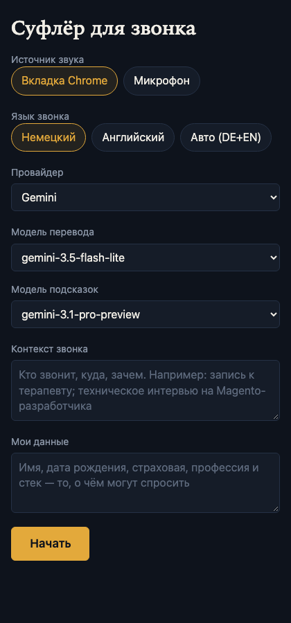
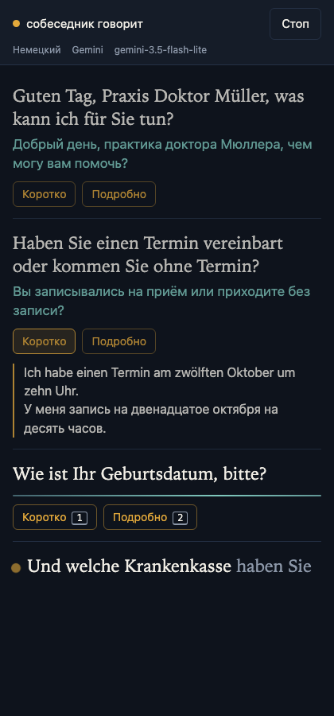

# AI Prompter

Local web app: live DE/EN call transcription with Russian translation and on-demand reply hints.

It listens to the audio of a Chrome tab (for example a Google Meet call), shows what the other person says in the original language, translates each sentence into Russian, and suggests an answer when you ask for one.

> Status: work in progress. The full brief is in [SPEC.md](SPEC.md); changes are tracked with [OpenSpec](openspec/).

## Quick start

1. Install Node.js 20.12 or newer.
2. `npm install`
3. `cp .env.example .env` and fill in `DEEPGRAM_API_KEY` plus at least one of `GEMINI_API_KEY` / `ANTHROPIC_API_KEY`.
4. `npm run dev`
5. Open <http://localhost:5175> in Chrome (the dev server port is `WEB_PORT`, default 5175).

Production mode: `npm run build && npm start` serves everything from one process on <http://127.0.0.1:8787>.

Other commands: `npm test` (Vitest), `npm run typecheck`.

## Architecture

```
Call tab (Chrome) --getDisplayMedia--> web (React) --WebSocket /ws--> server (Node)
                                                                        |-- Deepgram (speech to text)
                                                                        '-- Gemini / Claude (translation, hints)
```

| Folder    | What it is                                              |
|-----------|---------------------------------------------------------|
| `shared/` | TypeScript types shared by server and web (the protocol) |
| `server/` | Express + WebSocket server, runs through `tsx`          |
| `web/`    | Vite + React 18 UI                                      |

The server listens on `127.0.0.1` only. API keys stay on the server.

## Translation

Every finished sentence is translated into Russian at once, in parallel, by the translation model you chose, and streamed into its card (about one second to the first words with the default fast Gemini model). A failed or timed-out (10 s) translation is retried once; after a provider rate limit the app says so in a short note, waits 2 seconds and retries. A card that still fails shows "перевод не получен" with a "повторить" button.

The prompt gives the model the call context and up to four earlier sentences (as context only); your personal data ("Мои данные") is never part of a translation request. Two messages were added to the protocol for this: `translation_start` (empties a card's translation when an attempt restarts) and `notice` (a short note that disappears by itself).

Known quirk: a small, fast model sometimes adds a bracketed German word that is not in the sentence when the call context makes it likely (for example "Termin" in a doctor's-appointment call).

## Floating window over the call

During a call, the button "Вынести поверх окон" moves the call screen into a small window (420 px wide) that Chrome keeps above all other windows, so it can sit over the video call (Chrome's Document Picture-in-Picture). Move it to an edge of the screen and resize it as you like; Chrome remembers its place. The buttons, scrolling and the keys `1` / `2` work in it when it has the focus. Close it, or press "Вернуть" in the main page, to bring the screen back.

Limits: the window is opaque and cannot be made click-through (browsers do not allow it); the main page with the call must stay open (it can be minimised or in the background, because capture and the connection run there); only Chrome (116 and newer) can do this, and the button is hidden elsewhere. Checked automatically: the API exists in Chrome and refuses without a real click, and everything the app does with the window is covered by tests with a stand-in window. Opening it with a real click has to be tried by hand.

## Reply hints

"Коротко" suggests one polite answer in at most two sentences, in the language of the question, with its Russian translation; "Подробно" gives a cheat sheet: the gist, three to five short points and a Russian block (for a technical question such as "Wie erstellt man einen Indexer in Magento 2?"). Hints are built only when you press a button (or `1` / `2`), stream into the card, and a new request for the same sentence replaces the old one.

**Privacy note:** hints are the only requests that include your "Мои данные" text (and the call context), so the model can answer for you. Translation never sees it. Nothing is stored by the server, and the server log never contains it.

Notes from live testing: models count "thinking" tokens against the token limit, so requests ask for minimal thinking (Gemini 3.5 flash with the default limits otherwise spends almost everything thinking). The default hint model is the plain flash of the same generation as the translation model; "pro" models are available in the list but often have no free quota (HTTP 429), and the very newest flash models were overloaded or slow to start.

## The screens

**Setup.** Choose where the sound comes from (a Chrome tab or the microphone), the language (German, English or automatic German + English), the provider and the two models, and optionally describe the call and your own data. Your choices (but not the call description) are remembered in this browser. Pressing "Начать" opens Chrome's share dialog: pick the call tab and tick "Also share tab audio", otherwise the app tells you what to fix.

**Call.** The header shows what the app is doing and a stop button. Each sentence of the other person gets an entry: the original in large type, its translation below, and the buttons "Коротко" / "Подробно" for a reply hint. Keys `1` and `2` do the same for the newest sentence (not while you type in a field). The phrase being spoken right now is shown at the bottom, its uncertain part in grey. The list follows new text until you scroll up, and resumes when you scroll back to the bottom. The layout works from 420 px wide, so it fits in a window next to the call.

If the connection to the server drops, the app reconnects up to 5 times (the sentences already on screen stay; their unfinished translations are marked as failed). After that, or when the server ends the session, use "Начать заново".

## Call session (`/ws`)

One WebSocket connection is one call. The first message must be a valid `start`; the server then opens a Deepgram stream, forwards audio, and sends back `status`, `interim` (the live phrase) and `sentence` messages. `stop` (or closing the tab) ends the session, delivering the last words first. Hints and re-translation are accepted but not implemented yet.

Only pages from your own machine may connect: the server refuses a WebSocket whose `Host` is not `localhost` / `127.0.0.1` / `[::1]` or whose `Origin` differs from `Host`. Without this, any web page open in your browser could use your API keys through `ws://127.0.0.1:8787/ws`.

The server log contains event names, provider and model names, and error codes, but never text from a call.

## Speech recognition

Audio goes to Deepgram's live endpoint (`wss://api.deepgram.com/v1/listen`) over a plain WebSocket, behind the `SttProvider` interface in `server/src/stt/`. Settings: `interim_results`, `smart_format`, `punctuate`, `endpointing=300`, `utterance_end_ms=1000`, `vad_events`; no `encoding`/`sample_rate`, because the browser sends a webm container. `language=multi` (Nova-3) covers German and English. A lost connection is retried after 0.5, 1, 2, 4 and 8 seconds; the browser is then asked to restart its recorder so the new connection gets a fresh webm header.

Differences from SPEC.md:

- `KeepAlive` is sent after 4 seconds of silence instead of 5: Deepgram closes a connection after 10 seconds without audio or `KeepAlive`, and its docs advise 3-5 seconds.
- Audio held while the first connection opens is dropped as a whole (and a recorder restart is requested) when it exceeds 5 seconds, because dropping only the oldest chunks would lose the webm header.
- Not yet verified: that Deepgram accepts the browser's webm/opus without an explicit `encoding`. The docs describe this for containers in general; it is confirmed only by a test with a real browser.

## LLM providers and models

The app supports Gemini and Claude behind one interface (`server/src/llm/`). A provider is available only if its API key is set; one key is enough. `LLM_PROVIDER` chooses the default and falls back to the first available provider (Gemini, then Claude).

Models are not listed in `.env`: at startup the server asks each provider's API for its models, keeps the text chat models (no speech, image, music or agent models), and preselects a fast model for translation (newest "flash-lite" / "haiku") and a stronger one for hints (newest "pro" / "sonnet"). The lists are cached for ten minutes. If the API cannot be asked, built-in model ids are used.

To pin the models yourself, set `GEMINI_MODELS` or `ANTHROPIC_MODELS` to a comma-separated list: exactly those are offered, the first is the translation default and the second the hint default.

Differences from SPEC.md:

- Models come from the provider APIs, not from `GEMINI_MODELS` / `ANTHROPIC_MODELS` (those are optional overrides).
- Fallback Claude ids are `claude-haiku-5-5` / `claude-sonnet-5-5` (the newest known) instead of `claude-haiku-4-5-20251001`.
- `GET /api/config` also returns `defaultTranslationModel` and `defaultHintModel` per provider.
- On the free Gemini tier, "pro" models may answer with a rate-limit error (HTTP 429); pick a flash model for hints in that case.

## WebSocket protocol

Defined once in [shared/protocol.ts](shared/protocol.ts) and imported by both sides. One socket (`/ws`) is one call session. Audio chunks are sent as binary frames; everything else is JSON with a `type` field.

Client to server:

| `type`        | Fields                                                                                   | When                         |
|---------------|------------------------------------------------------------------------------------------|------------------------------|
| `start`       | `language`, `provider`, `translationModel`, `hintModel`, `callContext`, `profile`        | first message after opening  |
| `hint`        | `id`, `mode` (`short` / `detailed`)                                                      | "Коротко" / "Подробно" pressed |
| `retranslate` | `id`                                                                                     | "повторить" pressed          |
| `stop`        | none                                                                                     | "Стоп" pressed               |

Server to client:

| `type`              | Fields                                                              |
|---------------------|---------------------------------------------------------------------|
| `status`            | `state`: `connecting`, `listening`, `speaking`, `reconnecting`, `stopped` |
| `interim`           | `finalText`, `interimText` (the live, unfinished phrase)            |
| `sentence`          | `id`, `text`, optional `language`                                   |
| `translation_delta` | `id`, `delta`                                                       |
| `translation_done`  | `id`                                                                |
| `translation_error` | `id`                                                                |
| `hint_start`        | `id`, `mode` (client clears the hint block)                         |
| `hint_delta`        | `id`, `delta`                                                       |
| `hint_done`         | `id`                                                                |
| `hint_error`        | `id`                                                                |
| `restart_recorder`  | none (client restarts `MediaRecorder` after a reconnect)            |
| `error`             | `message` (Russian, human-readable)                                 |

`GET /api/config` returns `{ defaultProvider, providers: [{ id, label, models, defaultTranslationModel, defaultHintModel }] }` and never contains keys.

## Screenshots

Sample content, rendered at 420 px width (the setup form and a call in progress):

 

## Ports

| Port | Used by                                   |
|------|-------------------------------------------|
| 8787 | Node server (`PORT`)                      |
| 5175 | Vite dev server (`WEB_PORT`), proxies `/api` and `/ws` to 8787 |

SPEC.md mentions 5173 for Vite; this project uses 5175 because 5173 is taken on the author's machine.

## How to add a provider

A provider is a language model service behind the `LlmProvider` interface (`server/src/llm/types.ts`).

1. Write `server/src/llm/<name>.ts` with a factory that takes the service's client and returns `{ id, label, listModels(), stream(request) }`. `stream` yields text pieces, treats cancellation (`request.signal`) as a quiet end, and throws `LlmError` (use `toLlmError`) for failures; `listModels` returns only chat models (see `models.ts` for filtering and default choice). Test it with a fake client like `gemini.test.ts` does.
2. Add its id to `ProviderId` in `shared/protocol.ts`, and register it: add the key and optional model variables in `server/src/config.ts`, a factory in `server/src/llm/factories.ts`, and the label in the screens if needed.
3. Add the variables to `.env.example` (`<NAME>_API_KEY`, optional `<NAME>_MODELS`).
4. Run `npm run typecheck`: the compiler points at every place that must know about the new id.

Speech recognition works the same way behind `SttProvider` (`server/src/stt/types.ts`); Deepgram is the only implementation.

## Known limitations

- **Chrome only.** Tab-audio capture and the floating window rely on Chrome (116 or newer). On macOS, Chrome cannot capture the sound of other apps (Zoom/Teams desktop clients); use a browser tab, or the microphone with the speakerphone on.
- **Checked here only with synthesised speech, not with a real call in a browser.** The whole chain (speech, sentences, translation, hints, the origin check, reconnects at the code level) was exercised with tests and live API calls using generated German speech. Not verified automatically: the real share dialog with a Chrome tab, real `webm/opus` audio into Deepgram (the docs describe container formats in general), the floating window opened by a real click, and Claude (no Anthropic key was available; it is covered by tests with a fake client).
- **Free-tier API limits.** Pro-class Gemini models often have no free quota (HTTP 429); the default hint model is a plain flash for that reason. Parallel translations of fast speech can hit rate limits; the app shows a short note, waits 2 seconds, retries once, and offers "повторить".
- **Small fast models are not perfect translators.** For example, they may add a bracketed German word that was not said. Pick a stronger translation model on the setup screen if quality matters more than speed.
- **Sentence splitting is a heuristic.** Dots after one- or two-digit numbers ("am 12. Oktober") are treated as part of a date, so a sentence that really ends with such a number is joined with the next one. Common abbreviations are listed in `server/src/sentences.ts`.
- **One call at a time, local only.** The server listens on 127.0.0.1 and refuses WebSocket connections from other web sites; nothing is stored, and there are no accounts.
- **The floating window is opaque** and needs the main page to stay open.

### Differences from SPEC.md

The deviations are described where they apply: the Vite port 5175, models from the provider APIs, fallback Claude ids, `defaultTranslationModel` / `defaultHintModel` in `/api/config`, `KeepAlive` every 4 seconds, dropping all early audio on overflow, the protocol additions `translation_start` and `notice`, prompts written in English, and the floating window being part of v1.

